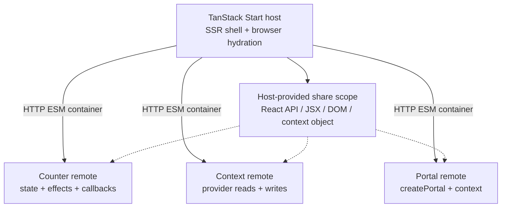

# Redact × Module Federation

**Yes: Redact 0.2.1 worked across the Module Federation boundaries tested here.**

A TanStack Start host renders three independently built Vite remotes. The same app runs in three configurations: React, Redact with default aliases, and Redact with explicit host-provided shared modules.

- [Live demo on Zephyr Cloud](https://beierkevin-64-start-host-redact-mf-lab-kevin-beie-b193894b1-ze.zephyrcloud.app/)
- [Detailed findings and limitations](docs/FINDINGS.md)
- [Recorded browser evidence](docs/evidence/results.json)
- [Reply draft](docs/REPLY.md)
- [Zephyr project](https://app.zephyr-cloud.io/org/kevin-beier/redact-mf-lab) (account access required)
- [Exact deployed host and remote URLs](deployments/zephyr.json)

The host includes an interactive identity table and a “What we learned” section. This is a scoped experiment, not a claim of universal React compatibility or federated SSR support.

## Reproduce

Use Node 24 (tested with 24.19.0) and npm. Ports 4100–4103 must be available.

```sh
git clone https://github.com/tonoizer/tanstack-redact-federation-lab.git
cd tanstack-redact-federation-lab
npm ci
npx playwright install chromium
npm run build -- all
npm run typecheck
npm run verify -- all
```

On a fresh Linux machine, use `npx playwright install --with-deps chromium`.

Local tests start and stop the production servers themselves. They do not need Zephyr credentials or Internet access after dependencies and the browser have been installed. Fonts are served locally.

Expected matrix: **React 5 passed / 1 skipped; default-alias Redact 6 passed; explicitly shared Redact 5 passed / 1 skipped.** The sixth test specifically checks the default-alias configuration’s different function identities and is skipped in the two singleton configurations.

Open the interactive demo separately:

```sh
npm start
```

Visit http://localhost:4100. The default is `redact-shared`. For the other builds:

```sh
npm start -- react
npm start -- redact-naive
```

Run one scenario with `npm run verify -- redact-shared`. Build one scenario with `npm run build -- redact-shared`.

## What to try

1. Increment local state in the counter remote.
2. Increment the host from that remote; watch the context remote update.
3. Edit the provider message in the host; read it in the context remote.
4. Open the portal remote and update shared state from inside its portal.
5. Unmount and remount the remotes; local state resets and host state survives.
6. Inspect strict function/context equality in the identity table.

The automated tests additionally delay one remote entry to exercise Suspense and abort it to check that the other two remain usable. They check that the server-rendered host heading retains its DOM identity through hydration.

## Architecture



The host uses the [Module Federation runtime API](https://module-federation.io/guide/runtime/runtime-api). Remotes use `@module-federation/vite` and expose `./Widget` through real `remoteEntry.js` containers. Application components retain ordinary `react` and `react-dom` imports. The shared context lives in the `@lab/contract` workspace package and is supplied by the host.

See [the exact build configuration](shared/build-config.ts) and [the host’s runtime registration](apps/host/src/federation.ts).

## Deploy to Zephyr

The live demo consists of **four separate applications** in project `redact-mf-lab`, organization `kevin-beier`:

| Application | Deployment |
| --- | --- |
| `counter` | Vite ESM Federation remote |
| `context` | Vite ESM Federation remote |
| `portal` | Vite ESM Federation remote |
| `start-host` | TanStack Start SSR Worker + browser assets |

The SDKs are installed and pinned. Deployment is opt-in; normal builds never publish. See [deployment details](docs/DEPLOYMENT.md).

```sh
npm run deploy
npm run verify:live
```

Authenticate using Zephyr’s normal SDK browser sign-in first if this machine is not logged in. The deployment script deliberately fails without valid credentials. It builds the three remotes, records their immutable URLs, builds the host against those URLs, and verifies HTTP availability. `verify:live` runs the same five functional browser tests against the deployed host and three remote origins.

The TanStack Start Zephyr adapter does not resolve `zephyr:dependencies` into URLs. This runtime-API host therefore pins the URLs returned by the remote deployments in [the deployment manifest](deployments/zephyr.json). It does not claim Zephyr selector resolution or automatic tag promotion.

## Evidence and checks

[GitHub Actions](.github/workflows/verify.yml) rebuilds and tests all three local configurations on Linux. Raw reports, screenshots, and failure traces are uploaded as workflow artifacts. A test run writes fresh local evidence to the ignored `artifacts/latest/` directory. The checked-in snapshot is in [docs/evidence](docs/evidence).

After running the local matrix and live verification, `node scripts/evidence.mjs` refreshes the checked-in evidence. It refuses reports with failed or flaky tests. File-size measurements are sums of separately gzipped emitted client JavaScript/CSS files; they are not page-transfer measurements or rendering benchmarks.

MIT licensed. Included fonts retain their SIL Open Font Licenses in `apps/host/public/fonts/`.
